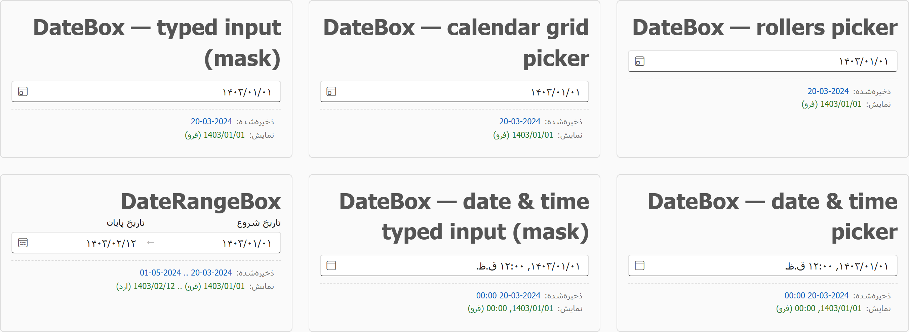
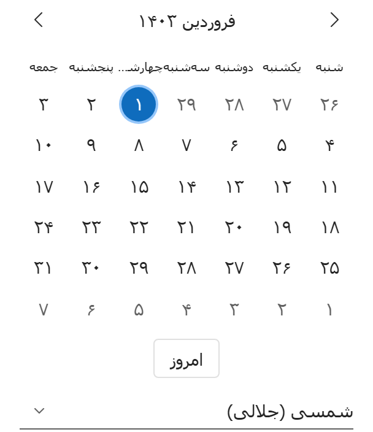
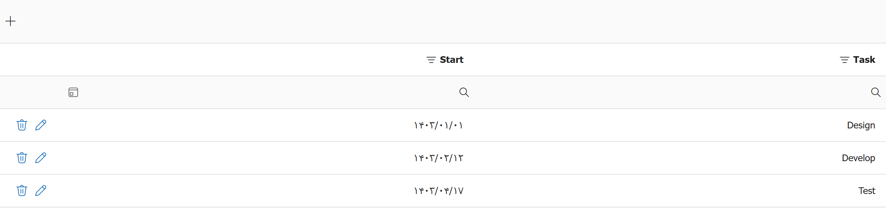
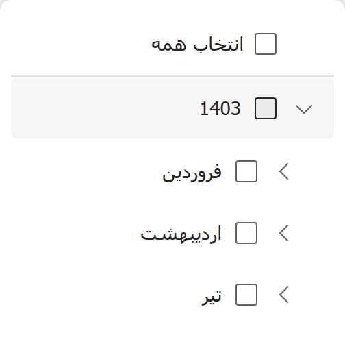
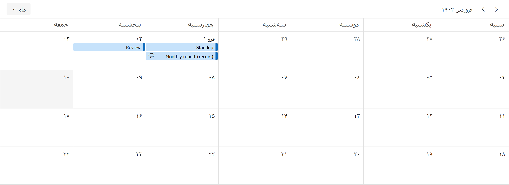
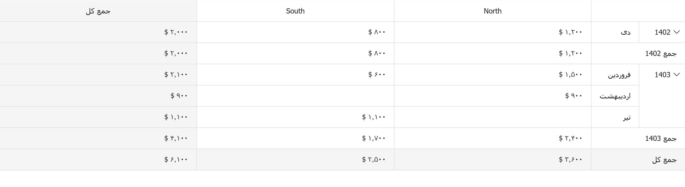
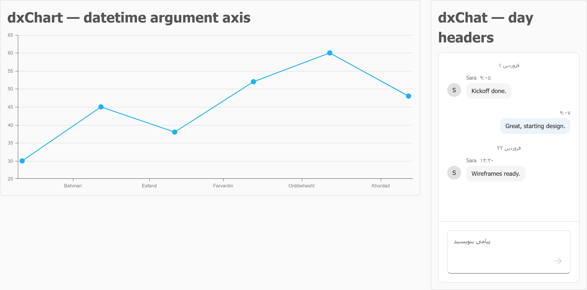
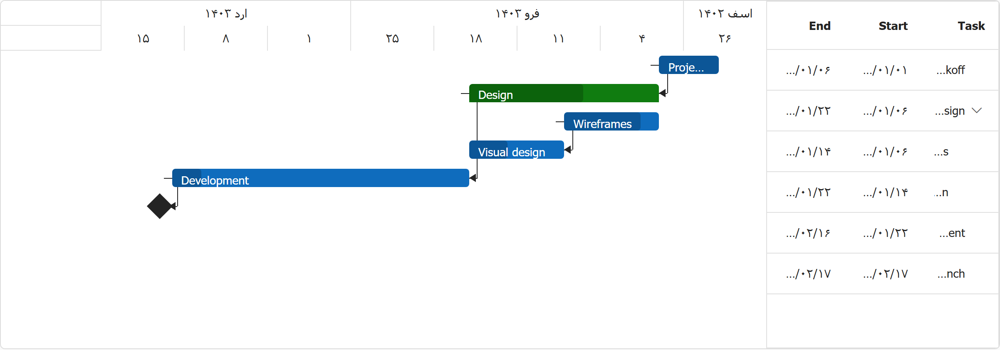

# DevExtreme — Multi-Calendar Fork

A fork of [DevExtreme](https://github.com/DevExpress/DevExtreme) that teaches the
components to **display, accept and group dates in non-Gregorian calendars** —
Persian (Jalali), Hijri (tabular), Hijri (Umm al-Qura), and any calendar you register
yourself.

> **Core invariant:** stored values stay native (proleptic Gregorian) `Date` objects.
> A calendar only affects **display, placement, input and grouping**. Sorting, filtering
> expressions, serialization and round-tripping are calendar-independent, so switching
> calendars requires **no data migration**.

Every calendar branch is guarded, so the Gregorian code path is unchanged.

## Screenshots

All screenshots below show the same dataset — Gregorian `Date`s — rendered with
`calendar: 'persian'` and the shipped `fa` locale (RTL).

**Editors** — `dxDateBox` (rollers, calendar grid, typed mask, date & time) and
`dxDateRangeBox`. Each panel prints the stored Gregorian value (blue) next to what
the user sees (green):



**Calendar picker** — all zoom levels render in the calendar, with the optional
in-picker calendar switcher at the bottom:



**DataGrid** — calendar-aware date column, filter row and inline editing; the
header-filter funnel builds a Year → Month → Day tree in the selected calendar:




**Scheduler** — the month grid starts on the 1st of the *calendar* month, the
navigator caption and day numbers follow the calendar, and monthly/yearly recurrence
recurs on the calendar day-of-month:



**PivotGrid** — date dimensions roll up by calendar year and calendar month:



**Chart & Chat** — datetime axis *tick placement* and labels land on calendar
boundaries; chat day-group headers render in the calendar:



**GanttMultiCalendar** — a calendar-aware Gantt with a two-tier timeline scale,
dependencies, drag/resize and dependency-aware auto-scheduling:



## Supported calendars

| Type string      | Calendar                  | Notes |
|------------------|---------------------------|-------|
| `gregorian`      | Gregorian (default)       | Unchanged code path; the default for every widget. |
| `persian`        | Persian / Jalali          | Borkowski/jalaali arithmetic, years −61…3177. |
| `hijri`          | Hijri / Islamic (tabular) | Julian-Day formulas. |
| `hijri-umalqura` | Hijri / Umm al-Qura       | Day-accurate via `Intl` ICU data; registered only when the runtime's `Intl` supports it. |
| *(custom)*       | Anything you register     | Implement the `CalendarSystem` contract and call `registerCalendar(...)`. |

A calendar can also advertise a preferred first day of week (Persian/Hijri = Saturday)
and a default date format (`yyyy/MM/dd`), used when the app has not set its own.

## What's calendar-aware

**Editors**
- `dxDateBox` — rollers picker (calendar year/month/day, correct day counts, RTL roller
  order), calendar-grid picker (month → year → decade → century), typed mask input
  (per-part increment, day clamping, paste round-trip), optional in-picker calendar switcher.
- `dxDateRangeBox` — both editors and the dropdown; forwards `calendar` / `calendarSwitcher`.
- `dxCalendar` — every zoom level, calendar default first-day-of-week and format,
  optional in-picker switcher.

**Data widgets**
- `dxDataGrid` / `dxTreeList` — date column display, inline editing, filter-row editor,
  header-filter Year → Month → Day tree, filter-panel / filter-builder value text.
- `dxPivotGrid` — grouping by calendar year and calendar month.
- `dxFilterBuilder` — condition value text for `date` / `datetime` fields.

**Scheduler** — day/week/timeline header day numbers, navigator caption, month-view
boundaries, `agenda` and `timelineWeek` labels, appointment tooltip and body text,
appointment popup date editors, and MONTHLY/YEARLY recurrence (including
`BYMONTHDAY`, negative `BYMONTHDAY`, BYDAY-monthly such as `1MO` / `-1FR`, and
`YEARLY;BYMONTH;BYDAY`), composed with `timeZone`.

**Visualization** — `dxChart` datetime axis labels *and* tick placement;
`dxRangeSelector` scale labels.

**Communication** — `dxChat` day-group headers.

**Project management** — `dxGanttMultiCalendar`, a native calendar-aware Gantt
(two-tier scale, bars, dependencies, drag/resize, dependency-aware auto-scheduling).
It exists as a separate widget because the stock `dxGantt` timeline is rendered by the
closed-source `devexpress-gantt` engine, which exposes no per-tick scale hook.

## Public API

| Widget | Option(s) |
|--------|-----------|
| `dxDateBox`, `dxDateRangeBox` | `calendar`, `calendarSwitcher` |
| `dxCalendar` | `calendar`, `calendarSwitcher` |
| `dxScheduler` | `calendar` |
| `dxChat` | `calendar` |
| `dxChart`, `dxRangeSelector` | axis/scale `label: { calendar }` (or `label.format: { type, calendar }`) |
| `dxDataGrid` / `dxTreeList` | column `format: { type, calendar }`, `editorOptions: { calendar }` |
| `dxFilterBuilder` | field `calendar` or `format: { type, calendar }` |
| `dxGanttMultiCalendar` | `calendar`, `scaleType` |

```js
$('#datebox').dxDateBox({ value: new Date(), calendar: 'persian', pickerType: 'calendar' });

$('#grid').dxDataGrid({
  columns: [{
    dataField: 'd',
    dataType: 'date',
    format: { type: 'shortdate', calendar: 'hijri-umalqura' },
    editorOptions: { calendar: 'hijri-umalqura' },
  }],
});

$('#sched').dxScheduler({ calendar: 'persian', views: ['day', 'week'], currentView: 'week' });
$('#chart').dxChart({ argumentAxis: { label: { calendar: 'persian' } } });
$('#chat').dxChat({ calendar: 'persian' });
```

Register your own calendar:

```js
import { registerCalendar } from 'devextreme/common/core/localization/calendar';

registerCalendar({
  type: 'mycal',
  toParts, fromParts, getDaysInMonth, getMonthsInYear, isLeapYear, getMonthNames,
});
```

The registry also exports `getCalendar`, `isCalendarRegistered`,
`getRegisteredCalendarTypes`, `getCalendarFirstDayOfWeek`,
`getCalendarDefaultDateFormat` and `getCalendarMonthNamesInActiveLocale`.

## Try it

Three Vite playground pages import the TypeScript source directly, so they reflect
local changes with no bundle build:

```bash
pnpm install
pnpm nx build:localization:generate devextreme     # generates CLDR data (required)
cd packages/devextreme-scss && pnpm exec gulp style-compiler-themes-ci
cd ../devextreme && pnpm dev:playground            # http://localhost:3000
```

| Page | Widgets |
|------|---------|
| `/calendar-multi.html` | DateBox, DateRangeBox, Calendar, DataGrid, PivotGrid, Scheduler |
| `/viz-chat-multi.html` | dxChart, dxChat |
| `/gantt-multi-calendar.html` | dxGanttMultiCalendar |

Unit tests (jsdom, no browser):

```bash
cd packages/devextreme
pnpm test-jest -- --testPathPattern calendar
```

## Documentation

- [`MULTI_CALENDAR.md`](MULTI_CALENDAR.md) — full feature index, architecture and known limitations
- [`packages/devextreme/js/__internal/core/localization/calendar/README.md`](packages/devextreme/js/__internal/core/localization/calendar/README.md) — developer guide and public API
- [`packages/devextreme/js/__internal/core/localization/calendar/VISUAL_TESTING.md`](packages/devextreme/js/__internal/core/localization/calendar/VISUAL_TESTING.md) — step-by-step visual guide

## Known limitations

- The **stock `dxGantt`** timeline scale cannot be made calendar-aware — the external
  closed-source `devexpress-gantt` engine exposes no per-tick scale-text hook. Use
  `dxGanttMultiCalendar` instead.
- Scheduler `YEARLY;BYDAY` without `BYMONTH` delegates to the Gregorian RRULE engine.
- **Remote/server-side** grouping paths stay Gregorian; only client-side
  grouping and formatting are calendar-aware.

---

# DevExtreme

DevExtreme is an enterprise-ready suite of powerful, engaging UI components for popular front-end frameworks: Angular, React, Vue, and jQuery.


DevExtreme components are responsive and accessible. They work well across different devices, screen sizes, and input methods. Whether your target audience uses phones, PCs or screen readers - DevExpress components are up to the task.

Our range of powerful, modern JavaScript components includes data grids, interactive charts, data editors and widgets. View the [Demo Gallery](https://js.devexpress.com/Demos/WidgetsGallery/) to see our components in action.

- Official website: [js.devexpress.com](https://js.devexpress.com)
- Pricing: [js.devexpress.com/buy](https://js.devexpress.com/Buy)
- Licensing: [js.devexpress.com/licensing](https://js.devexpress.com/Licensing)
- Support: [www.devexpress.com/support](https://www.devexpress.com/support)

## Getting Started

The DevExtreme website includes "Getting Started" guides for every aspect of DevExtreme:

- Angular
    - [Create a DevExtreme Angular Application](https://js.devexpress.com/Angular/Documentation/Guide/Angular_Components/Getting_Started/Create_a_DevExtreme_Application/)
    - [Add DevExtreme to an Angular Application](https://js.devexpress.com/Angular/Documentation/Guide/Angular_Components/Getting_Started/Add_DevExtreme_to_an_Angular_CLI_Application/)

- React
    - [Create a DevExtreme React Application](https://js.devexpress.com/React/Documentation/Guide/React_Components/Create_a_DevExtreme_Application/)
    - [Add DevExtreme to a React Application](https://js.devexpress.com/React/Documentation/Guide/React_Components/Add_DevExtreme_to_a_React_Application/)

- Vue
    - [Create a DevExtreme Vue Application](https://js.devexpress.com/Vue/Documentation/Guide/Vue_Components/Create_a_DevExtreme_Application/)
    - [Add DevExtreme to a Vue Application](https://js.devexpress.com/Vue/Documentation/Guide/Vue_Components/Add_DevExtreme_to_a_Vue_Application/)

- jQuery
    - [Add DevExtreme to a jQuery Application](https://js.devexpress.com/jQuery/Documentation/Guide/jQuery_Components/Add_DevExtreme_to_a_jQuery_Application/)

## Learn

- [Demo Gallery](https://js.devexpress.com/Demos/WidgetsGallery)
- [Responsive UI Templates](https://js.devexpress.com/Templates/UITemplates)
- [Documentation](https://js.devexpress.com/Documentation)
- [Examples on GitHub](https://github.com/DevExpress-Examples)
- [YouTube videos](https://www.youtube.com/playlist?list=PL8h4jt35t1wjGvgflbHEH_e3b23AA30-z)

## Contributing

The DevExtreme team welcomes outside contributions of bug reports and feature requests. Read our [contribution guidelines](CONTRIBUTING.md) for more information.
